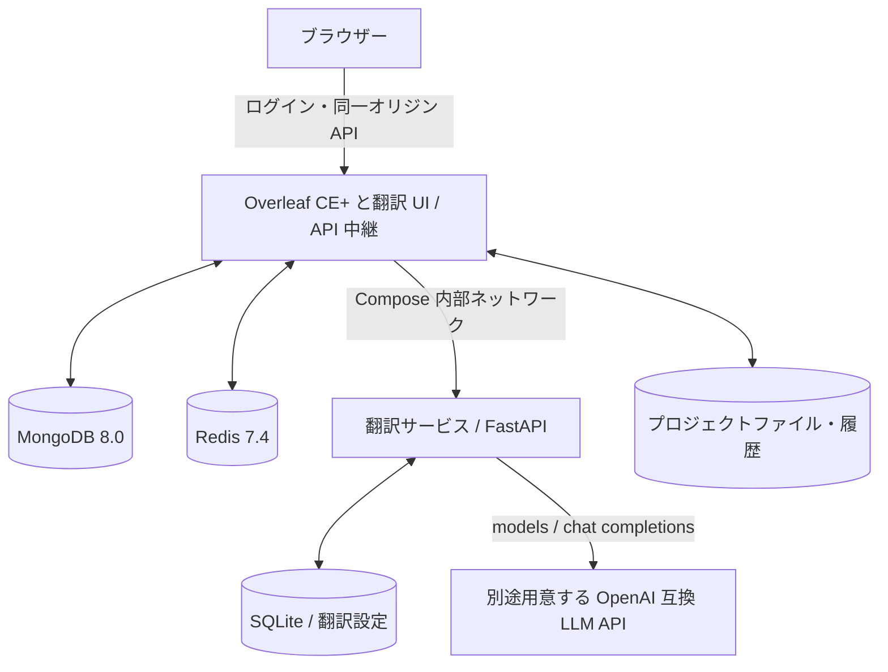

# 構成と現状

[README](../README.md) · [セットアップ](SETUP.md) · [移行](MIGRATION.md)

本書は現在のソース構成と確認範囲を説明します。過去の作業記録は [CE+ 統合記録](CE_PLUS.md) と [統合前の記録](archive/PROJECT_STATUS_PRE_CE_PLUS.md) に分離しています。上流の最新状態や差分行数を固定値で表すものではありません。

## 構成

Compose の `sharelatex` には web・文書同期・履歴・コンパイル等の Overleaf サービスと CE+ の linked-url-proxy が含まれます。日本語 TeX Live もこのイメージにあります。LLM サーバーとモデルは Compose に含まれません。LLM が停止しても通常編集・コンパイルは利用できます。

## 機能の範囲

| 分類 | この構成での扱い |
| --- | --- |
| 日本語 LaTeX | フル TeX Live、日本語クラス・フォントをビルド定義に含む。プロジェクトで LuaLaTeX を選ぶ |
| ローカル LLM 翻訳 | 独自 UI / API と FastAPI サービス。LLM の準備は別途必要。接続先はユーザーの LLM 設定画面（BYO 行＋翻訳専用欄）で選び、「標準設定に従う」場合は翻訳サービス側の名前付きエンドポイント（標準設定・追加パラメータ・ミニマルプロンプト）→ `.env` の順にフォールバック。翻訳・AI チャット・横並び表示（タブ編集環境）は左セクションのタブ |
| PDF 切り替え | メイン文書ごとに最大4件をブラウザーの編集セッション内に保持。移行データに含めない |
| CE+ の変更追跡・コメント、シンボルパレット、テンプレート管理、参考文献検索等 | ソース・モジュールを統合。外部検索や変換等は接続先・利用機能ごとの動作確認が必要 |
| Git ブリッジ | 有効化済み。`git-bridge` サービス（ソースからローカルビルドの `local/overleaf-git-bridge`）を追加。nginx の `/git/` 中継で認証 401 応答を確認 |
| GitHub / Zotero / LDAP / SAML / OIDC 等 | 連携コードは CE+ に由来。GitHub / Zotero は鍵の取得待ち（変数ひな形は `.env.example`）。他は接続先設定を自動構築しない |
| Sandboxed Compiles / TeX Live イメージ選択 | 本 Compose では未構築。本体コンテナ内でコンパイルする |
| HTTPS・DNS・Tailscale・LLM・GPU | ホストまたは外部サービス側で構築・移行する |

翻訳 API はログインを要求し、文書の操作にはプロジェクトの権限を確認します。翻訳の接続先はユーザーごとの LLM 設定画面（BYO 行）で選び、API キーはサーバー側で暗号化保存してブラウザーへは返しませんが、自分が入力した外部 URL へ原文が送ることもできます。単独運用または信頼する利用者での運用を前提にしてください。

## データと設定

| Compose volume | 標準の実名 | コンテナ内 |
| --- | --- | --- |
| `overleaf_data` | `overleaf-local_overleaf_data` | `/var/lib/overleaf` |
| `mongo_data` | `overleaf-local_mongo_data` | `/data/db` |
| `redis_data` | `overleaf-local_redis_data` | `/data` |
| `translation_data` | `overleaf-local_translation_data` | `/data`（`translation.sqlite3`） |

`.env` とイメージは volume のバックアップとは別に保存します。UI 保存の接続先・API キー・名前付きエンドポイント（標準設定・追加パラメータ含む）・用語集・プロジェクト設定は翻訳用 SQLite に含まれます。LLM のモデル重みはこれらの volume にありません。[移行手順](MIGRATION.md)に全対象を記載しています。

## 主な実装の場所

| 場所 | 役割 |
| --- | --- |
| `compose.yaml` / `compose.lan.yaml` | 起動・永続化・公開先 |
| `compose.restore.yaml` | 復元時に初期ファイルを volume へコピーしない追加設定 |
| `scripts/build-images.sh` | 全イメージの順序付きビルド |
| `scripts/init-mongodb-replica-set.sh` | `mongo:27017` の単一ノード replica set 初期化 |
| `server-ce/Dockerfile-base` / `Dockerfile.jp-base` | フル TeX Live と日本語クラス・フォント |
| `server-ce/Dockerfile` | CE+ と独自機能を含むアプリ |
| `server-ce/nginx/overleaf.conf.template` | CE+ の Nginx・翻訳 SSE 中継設定 |
| `services/web/config/settings.defaults.js` | CE+ と翻訳モジュール・左レールタブ（英語翻訳 / 横並び表示 / AI Assistant）・横並び表示パネルの登録 |
| `services/web/modules/local-llm-translation/` | 翻訳 UI（左レール）、横並び表示（タブ編集環境）、認証・権限チェック、API 中継（翻訳専用設定の接続オーバーライド注入）、英語版保存 |
| `services/web/modules/llm/` | LLM チャットレール・Ask AI・BYO 設定（/user/llm-providers）、翻訳専用設定（/user/llm-translation-settings）、管理者設定 |
| `translation-service/app/` / `translation-service/tests/` | LLM 接続、保護・分割・検証、SQLite、回帰テスト |
| `NOTICE.md` / `docs/LICENSE_REVIEW.md` | 改変・出典・権利表記と公開前の未解決事項 |
| `scripts/license-inventory.cjs` | ビルド済みアプリの Node 依存ライセンス表記を収集 |
| `services/web/frontend/js/shared/context/local-compile-context.tsx` | メイン文書ごとの PDF・ログキャッシュ |

## 確認状況

2026-11-09 に稼働環境を読み取り専用で確認しました。

- `sharelatex` は running、MongoDB・Redis・翻訳サービスは healthy。
- `mongo-init` は Exited (0)。
- 使用中のイメージは `linux/amd64`。Overleaf アプリは約22.6 GB。

同日のドキュメント整備では以下も確認しました。

- 通常・LAN・復元用 Compose の設定検証、復元対象4 volume の `nocopy` のマージ。
- 別の一時 Compose プロジェクトでコンテナ作成（起動せず）と空 volume の確保。
- 模擬データで全4 volume の tar 保存・復元、日本語ファイル名、シンボリックリンク、数値 UID / GID・権限の保持、空でない復元先の拒否。
- アーカイブの SHA-256 検証と作業用小型イメージの save / load。
- 翻訳サービスの回帰テスト26件成功（LLM 呼び出しは模擬）。
- ドキュメント内のローカルファイルリンクとシェル例の構文検査。

同日の長文翻訳修正では、`test` プロジェクトのログで、10チャンクの完了後に
第1・4・7チャンクが全体検証で原文へ戻されることを確認しました。
実LLMの応答ではコメント末尾の空白による誤検出と、本文への数式・構文追加を
確認しています。コメント・定義行は改行まで保護し、構文検証もチャンク確定前に
行って分割再試行へ渡すよう修正しました。文体プロンプトを変更しても数式・
コマンドの新設を禁止する固定指示を維持します。長文・コメント空白・一時的／
恒常的な構文エラー・固定指示を含む回帰テスト31件が成功しています。

実LLMでは失敗箇所を絞って検証し、固定指示の補強後は第4チャンク全体が
再試行なしで構文検証を通過しました。検証では対象外のチャンクは原文を通しており、
原稿全体の再翻訳・既存英訳への上書きは行っていません。修正版は翻訳サービスだけを
再作成して適用済みで、healthy とモデル一覧取得（HTTP 200）を確認しています。
切り替え前の SQLite とイメージIDは Git 管理外の
`backups/translation-fix-20261109/`、旧イメージは
`local/overleaf-translation:before-long-doc-fix-20261109` に保持しています。

2026-11-12 の更新です。CE+ 機能の有効化（Git 統合・テンプレートギャラリー・URL
リンク付きファイル。詳細は [CE+ 統合メモ](CE_PLUS.md)）と、左セクションの再設計を
行いました。

- 翻訳の入口をエディターツールバーから左セクション（ファイルツリーの列）の
  「英語翻訳」タブへ移し、同じ列にクラウド版と同じ形式の「AI アシスタント」タブを
  新設しました（会話履歴は翻訳サービスの SQLite にプロジェクト単位で保存）。
- 日本語原文と英語版 `.tex` の横並び表示パネルを追加しました（翻訳保存後に自動で
  開き、docstore 最新版の読み込みと通常編集経路での保存、同一ファイル同時編集時は
  読み取り専用）。
- アシスタントパネルに会話専用の接続先選択を追加しました（翻訳設定を変えず、
  Gemma などの汎用モデルへ相談だけ切り替えられます）。LM Studio（Gemma4 相談用）
  をエンドポイントとして登録済みです。

公開後の目視確認で 3 件の不具合が分かり、次の修正を入れました。

- 「英語翻訳」タブが .tex を開いても案内表示のまま: CodeMirror ブリッジ経由の
  エディタ検出に依存しすぎていたため、公式の EditorManager・ファイルパスから
  .tex を判定する方式に変更（選択範囲翻訳だけブリッジ继续使用）。
- 「AI アシスタント」の会話欄が真っ白: Overleaf 公式エラー境界のフォールバックが
  空要素で、クラッシュ时无表示になっていた。全パネルに日本語のエラー表示を
  備えた境界を付け、文字色・背景も全パネルで明示指定。
- 横並びパネルの開き口が翻訳保存時しかなかった: 左セクションに「横並び表示」
  タブを追加（ファイル一覧・開いているファイルの横並び化・閉じる）。
- 翻訳サービスの回帰テスト42件成功。アシスタントの SSE 1 往復・履歴保存・消去を
  実機（plamo 接続）で確認。左セクションと横並びパネルのブラウザー表示は
  実運用画面での目視確認が必要です。

ドキュメント整備の検証用コンテナ・volume は削除しました。Overleaf本体・MongoDB・Redisは停止・再作成していません。今回Overleaf本体のフルイメージの再ビルド、全volumeの停止バックアップ、別PC上のDB復旧は実施していません。

## 2026-11-12（その2）: LLM モジュール移植と翻訳設定の統合

- ext-ce-llm ブランチの LLM モジュール（AI Assistant チャット、Ask AI、インライン
  補完、文書生成、コンパイル修正、準拠レビュー、BYO 設定、管理者設定）を移植し、
  旧自作 AI アシスタントはチャットレールへ統合した。
- 翻訳の接続設定を LLM 設定画面へ統合した（Phase 2）。翻訳パネルの接続系 UI は
  廃止し、「英語翻訳の接続設定」欄（BYO 行 + モデル・ミニマルプロンプト・
  チャンク字数）へ集約。翻訳サービス側エンドポイントは標準 lane の
  フォールバックとして内部に残る。
- AI 機能ごとのモデル選択を追加した（`User.llmFeatureModels`、
  GET/POST `/user/llm-feature-models`）。AI Assistant・Ask AI・インライン補完・
  文書生成・コンパイル修正・準拠レビューの 6 機能について、BYO 行のモデルを
  機能別に指定でき、未指定は共有選択 → サーバー既定へ従う。リクエスト側で
  モデルを明示した場合はそれが常に優先。
- AI Assistant / Ask AI の入力欄で、日本語 IME の変換確定の Enter で送信されない
  よう修正した（`isComposing` / keyCode 229 の判定。送信は従来どおり Enter、
  改行は Shift+Enter）。
- AI Assistant チャットのプロジェクト TeX 自動参照を追加した
  （`LLMProjectContext.mjs`）。質問ごとに docstore 最新版の全 .tex/.bib/.sty/.cls
  をキーワードスコアリングし、編集中ファイルの冒頭 + 一致上位ファイルの抜粋を
  system メッセージとして添付（既定 12,000 字予算）。参照は読み取りデータ扱いの
  注記を添え、回答下部に使用ファイルを表示。2026-11-13 追加で質問意図の自動判定を入れた:
  auto モードでも「全体・校正・表記ゆれ」等の質問なら full へ昇格（既定 60,000 字）、
  質問中のファイル名（methods.tex 等）は全文寄り、セクション名（考察・method 等）は
  見出し付近を前方 2,600 字窓で重点収録（`WHOLE_INTENT_RE` / `detectFocusFiles` /
  `detectSectionHits`）。モード（自動/常に全体/オフ）と参照コンテキスト長（文字数、
  既定 auto 12,000 / full 60,000、上限 200,000）は LLM 設定画面の「AI 機能ごとの
  モデル選択」欄で管理（`User.llmChatContextMode` / `llmChatContextBudget`）。
  全体読み込みは予算超過ファイルを「省略」として明示。チャット画面にはスイッチを置かない。

これは稼働状態の確認であり、今回ブラウザー上の翻訳品質・共同編集・全 CE+ 機能を試験したという意味ではありません。初回起動などの過去の検証は [CE+ 統合記録](CE_PLUS.md)を参照してください。移行先では[セットアップの利用確認](SETUP.md#5-利用確認)と[復元後の確認](MIGRATION.md#5-起動確認切り替え)を行います。
