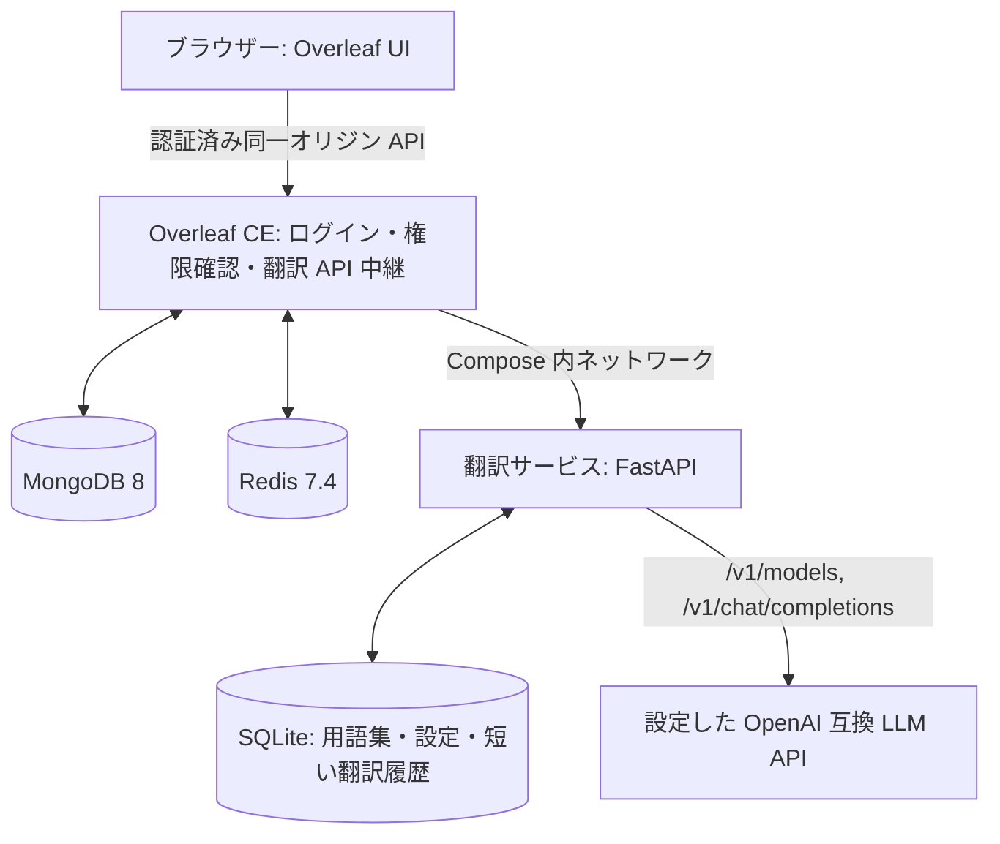

> この文書は CE+ 統合前の記録です。現在の統合元・検証結果は [CE+ 統合メモ](../CE_PLUS.md) を参照してください。

# プロジェクト現状レポート

確認日: 2026-11-08
対象: このリポジトリの作業ツリー

## 概要

この作業ツリーは論文原稿ではなく、Overleaf Community Edition（CE）のソース一式を基にしたセルフホスト環境です。公式 CE に次の変更を加えています。

- フルスキームの TeX Live と日本語クラス・フォントを使った日本語 LaTeX コンパイル
- ローカルまたは自分で管理する OpenAI 互換 LLM を使った日本語から英語への翻訳
- 日本語原稿と英語原稿を切り替えたときの、編集セッション内での PDF・ログ復元

**ソース上には上記の実装と起動設定があります。翻訳サービスの回帰テスト（14 件）は
コンテナ内で実行してすべて成功しています。一方、フル TeX Live イメージのビルドと
Compose 全体の起動は配布先ホストでまだ実証していないため、導入時に README の
手順で初回ビルド・起動確認をしてください。**

## 公式 Community Edition との差分

ここでいう「正規版」は Overleaf が公開している [Community Edition リポジトリ](https://github.com/overleaf/overleaf)です。比較基準は `main` のコミット `e039ad26c5bf5422eb57b89fc7e57c75055e631d`（2026-09-17）で、この作業ツリーの `main`（remote `upstream` の公式 `main` とも一致）が同じコミットを指し、追加変更はブランチ `jp-translation` に入っています。確認日（2026-11-08）時点の公式 `main` もこのコミットです。ホスト版 overleaf.com は非公開の Server Pro 機能・運用構成を含むため、公開ソースとの比較対象にはしていません。

| 分類 | 公式 CE 基準からの変更 | 影響 |
| --- | --- | --- |
| TeX Live | `scheme-basic` から `scheme-full` に変更し、ドキュメント・ソースも含める。CTAN ミラーを変更 | イメージサイズと初回ビルド時間が大きく増える。任意の TeX パッケージを使いやすくなる |
| 日本語組版 | 日本語クラス、LuaTeX-ja、日本語フォントを追加する専用ベースイメージ | LuaLaTeX で日本語文書をコンパイルできる構成を追加 |
| 翻訳機能 | Overleaf のツールバー・API モジュールと、Python/FastAPI の翻訳サービスを新設 | OpenAI 互換 LLM への日本語→英語翻訳、用語集、`.en.tex` 保存、保護構文検証を追加 |
| デプロイ | 公式の通常開発用 Compose とは別に、MongoDB / Redis / 翻訳サービスを含む `compose.yaml` とビルドスクリプトを追加 | この作業ツリー独自のイメージをビルドして起動する。公式 Toolkit の設定とは互換ではない |
| エディタの PDF 表示 | 既存のコンパイルコンテキストに、メイン文書ごとのセッション内キャッシュを追加 | 日本語版・英語版を切り替えた際、各文書の直近 PDF を復元 |
| 小規模な調整 | Yarn の有効化方法、Nginx の SSE 中継、モジュール登録、`.gitignore` を変更 | ビルド・翻訳ストリーム・ローカル運用に必要な接続部分 |

規模をファイル差分で見ると、公式から引き継いだ追跡済みファイルのうち7ファイルを変更しています（READMEを含めて365行追加、17行削除）。機能のために変更した既存 CE コードは5ファイルで、143行追加・12行削除です。それに加えて18個の新しいテキストファイル（Compose、Dockerfile、スクリプト、翻訳機能・テスト、設定例、文書）があります。翻訳 UI と翻訳サービスだけで約2,554行あり、回帰テストを含みます。残る約6,300件の既存ファイルは変更していません。

したがって、**Overleaf 本体の大部分を作り替えたものではありませんが、配布・ビルド・導入方法とエディタ機能は明確に独自化されています。** 公式 CE のままの単純な設定変更ではなく、追加コードとこの作業ツリー専用の Compose 設定を必要とする派生構成です。

公式 CE の README は新規セルフホストに [Overleaf Toolkit の Quick Start](https://github.com/overleaf/toolkit/blob/master/doc/quick-start-guide.md) を案内しています。この作業ツリーは独自のイメージと Compose 構成を使うため、その Toolkit 手順は使わず、後述のローカル導入手順に従います。

## 構成

ブラウザーに LLM の API Key は渡しません。Overleaf 側でログインとプロジェクト権限を確認した後、内部ネットワーク上の翻訳サービスへリクエストを中継します。翻訳サービスと LLM が停止しても、Overleaf の通常編集・コンパイルは独立して利用できる構成です。

## 実装されている追加機能

### 日本語 LaTeX

`server-ce/Dockerfile-base` は TeX Live の `scheme-full` を導入します。`Dockerfile.jp-base` は日本語向けの `bxjsarticle`、`jlreq`、LuaTeX-ja、Harano Aji・IPAex フォントなどを追加・確認します。Compose の Overleaf サービスは LuaLaTeX の実行時キャッシュを永続データ volume 内に置く設定です。

日本語本文は LuaLaTeX と `bxjsarticle` または `jlreq` 系クラスを使う手順が README にあります。既定の新規文書コンパイラーは pdfLaTeX なので、日本語文書ではプロジェクト設定の変更が必要です。

### ローカル LLM 翻訳

ソースエディタの LaTeX 文書に「英訳」ボタンを追加しています。翻訳対象は選択範囲または現在の `.tex` ファイルです。モデル一覧は設定先の `/v1/models` から読み込み、モデル、用語集、文書の概要・文体メモをプロジェクト単位で保存します。

翻訳サービスは LaTeX コマンド、参照・引用、コメント、数式、コード、URL、波括弧などを保護マーカーに置き換えてから文章部分を翻訳します。文書を段落単位に考慮して分割し、マーカーの順序と LaTeX 構造を検証します。検証に失敗したチャンクは小さく分割・同一サイズで最大3回まで再試行し、それでも失敗したチャンクは原文を保持して翻訳全体は続けます（完了時に失敗チャンク番号を通知）。文書全体の検証で問題を見つけた場合も、チャンク毎の再検証で不審なチャンクだけ原文へ戻して救済します。モデルが付加する前置き・後書きの定型文は確定前に除去します。既定のチャンク目安は3,600文字、文書上限は500,000文字です。

処理状況と生成中の訳文を SSE で送り、LLM の応答待ち中も15秒間隔で進捗を送信します。停止要求はブラウザーから Overleaf を経て LLM リクエストまで伝播します。全文翻訳は `main.en.tex` のような別ファイルへ保存でき、日本語原文は維持します。選択範囲翻訳を原文へ適用する場合は確認ダイアログを表示します。翻訳中に原文が変わった場合は、古い結果の保存・適用を止めます。

用語集は最大200項目、文書コンテキストは最大4,000文字です。翻訳サービスの SQLite にはプロジェクト設定と直近3件の翻訳メモが保存されます。メモはそれぞれ原文・訳文の末尾最大700文字で、全文書の翻訳履歴は保存しません。

### 複数メイン文書の PDF 切り替え

`services/web/frontend/js/shared/context/local-compile-context.tsx` により、メイン文書ごとの成功したコンパイル結果を編集セッション内で最大4件保持します。英語版へ切り替えると以前の PDF とログを復元し、未コンパイルの文書では別文書の PDF を表示しないようにします。文書に変更があった結果は古いものとして扱います。このキャッシュはブラウザー内の一時状態で、ページを再読み込みすると失われるため、必要な文書を再コンパイルします。

## 主なファイル

| 場所 | 役割 |
| --- | --- |
| `compose.yaml` | Overleaf、MongoDB、Redis、翻訳サービスのローカル構成。既定で Overleaf のみ `127.0.0.1:8080` に公開 |
| `compose.lan.yaml` | `.env` に指定した LAN・Tailscale IPv4 への追加公開設定 |
| `scripts/build-images.sh` | CE ベース、日本語対応ベース、Overleaf、翻訳サービスのイメージをビルド |
| `scripts/init-mongodb-replica-set.sh` | Overleaf 用 MongoDB replica set の初期化 |
| `Dockerfile.jp-base` | 日本語 TeX Live パッケージ・フォントの追加 |
| `server-ce/Dockerfile-base` | CE ベースイメージにフルスキームの TeX Live を導入 |
| `server-ce/Dockerfile` | Overleaf アプリイメージを構築し、Yarn を事前有効化 |
| `server-ce/nginx/overleaf.conf` | 翻訳 SSE の中継先とバッファリング無効化 |
| `services/web/config/settings.defaults.js` | 翻訳モジュールとエディタボタンを CE に登録 |
| `services/web/modules/local-llm-translation/` | Overleaf 側の翻訳 UI、認証・権限付き API、翻訳サービスへの中継 |
| `translation-service/app/` | FastAPI、OpenAI 互換 API 接続、SQLite 保存、LaTeX 保護・分割・検証 |
| `services/web/frontend/js/shared/context/local-compile-context.tsx` | 文書ごとのコンパイル結果キャッシュ |
| `.env.example` | ローカル起動・LLM 接続用の設定例。実際の `.env` は Git から除外 |
| `README.md` | 初回起動、日本語コンパイル、翻訳、保存・バックアップ、更新、トラブル対応の手順 |

ルートには CE の開発用 `docker-compose.yml` もあります。このローカル構成を起動するときは、README のとおり `compose.yaml` を明示します。

## データの保存先と接続範囲

Compose は次の名前付き volume を使います。

- `overleaf-local_overleaf_data`: `/var/lib/overleaf`。プロジェクトファイルなど
- `overleaf-local_mongo_data`: MongoDB のデータ
- `overleaf-local_redis_data`: Redis の永続データ
- `overleaf-local_translation_data`: SQLite の用語集、モデル設定、文書メモ、短い翻訳履歴、UI 保存の LLM 接続先

MongoDB、Redis、翻訳サービスはホストポートを公開せず、Compose 内ネットワークで通信します。既定の Overleaf 公開先は loopback です。LAN / Tailscale 公開は別 Compose ファイルと明示的な IPv4 設定が必要です。

翻訳対象の原文と用語集は、設定した LLM API に送信されます。接続先がローカル機器とは限らないため、機密文書を扱う前に接続先とそのデータ取り扱いを確認してください。`.env` は秘密値を含むため Git に登録せず、導入先で `.env.example` から作成します。

LLM 接続先（base URL・API キー）は `.env` のほか、翻訳パネルの「LLM接続先」欄からも変更できます。保存値は翻訳サービスの SQLite に置かれ、`.env` より優先されます。API キーは翻訳サービスのみが保持し、ブラウザーへは「設定済みか否か」だけが届きます。「接続テスト」は保存前に到達確認だけができ、「.env 設定へ戻す」で保存値を消して環境変数設定へ復帰できます。

翻訳のシステムプロンプトもプロジェクト単位で編集できます（パネルの「用語集・文書コンテキスト・システムプロンプト」欄）。編集できるのは翻訳のスタイル・役割の指示だけで、保護マーカー維持や「訳文のみ出力」など LaTeX 検証の前提となる指示は翻訳サービスが常に末尾へ自動で添えます。空欄に戻すと既定文へ復帰でき、パネルに「デフォルトに戻す」ボタンがあります。

## 作業ツリーと検証状況

Git の構成は配布用に整理しています。

- ブランチ `main` は公式 CE のコミット `e039ad2` のままにし、公式の更新は `upstream` remote から取り込めます。
- 追加変更（日本語 TeX Live・翻訳機能・PDF キャッシュ・Compose 構成）はブランチ `jp-translation` に論理単位でコミットしています。比較は `git diff main..jp-translation` で行えます。
- Python バイトコード（`__pycache__/`）は削除し、`.gitignore` に追加しました。`.env.example` の LLM 接続先は環境非依存のプレースホルダーです。

検証状況は次のとおりです。

- 翻訳サービスの回帰テスト 14 件は、`python:3.12-slim` コンテナ内で実行しすべて成功（`python -m unittest discover -s tests`）。
- `compose.yaml` / `compose.lan.yaml` は `docker compose config` で検証済み。
- 追加した JS / TSX / Python は構文チェック済み（esbuild・node --check・py_compile）。
- フル TeX Live イメージのビルドと Compose 全体の起動は配布先ホストでの実操作が必要なため未実施。

## 次に運用状態を確認するとき

Docker デーモンにアクセスできるホストで、README の順にイメージをビルドし、Compose サービスを起動します。その後、少なくとも次の項目を個別に確認してください。

1. `docker compose -f compose.yaml ps` で各サービスの状態を確認する。
2. Overleaf に管理者アカウントでログインし、LuaLaTeX による日本語の最小文書をコンパイルする。
3. 翻訳 UI からモデル一覧を取得し、短い `.tex` を翻訳して別名の `.en.tex` として保存する。
4. 日本語版・英語版を切り替え、各版の PDF 表示と再読み込み後の再コンパイル動作を確認する。
5. 継続利用する前に、README の手順で全 volume のバックアップと復元方法を確認する。

具体的な起動・管理コマンドは[README のセルフホスト手順](../../README.md)を参照してください。
